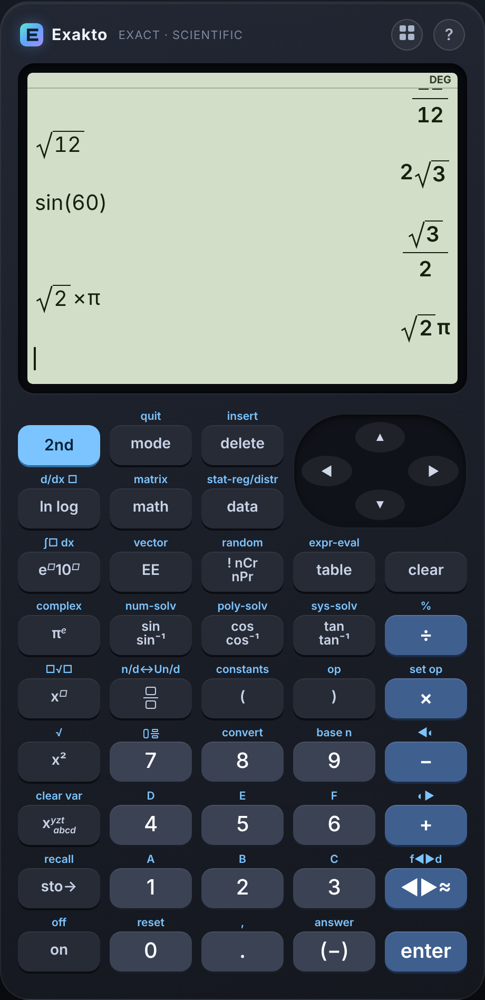
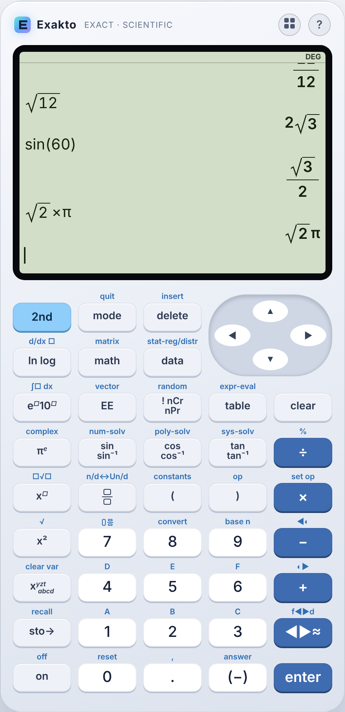
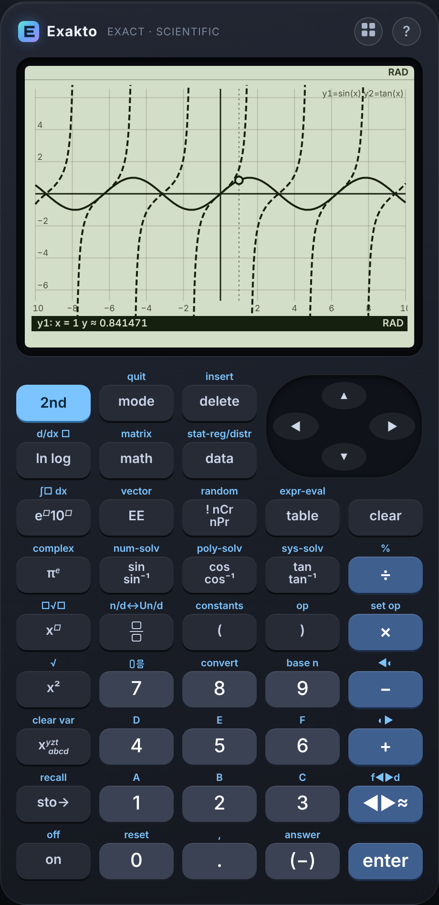
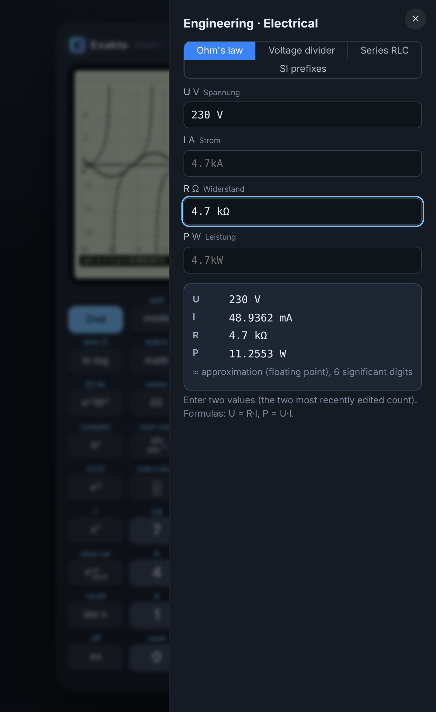

<div align="center">


# Exakto

**Exact mathematics. Anywhere.**

Scientific · Offline · Open Source

   

Fractions, roots and π stay exact – textbook-style display, works offline, zero dependencies.

[Deutsch](README.md) · [English](README.en.md)

 &nbsp; 

</div>

## Why Exakto?

Many school and university calculators work exactly (`2/3 + 1/4 = 11/12`, `√12 = 2√3`), but there is hardly anything comparable for the browser. Exakto brings that way of working to your PC: usable with mouse, keyboard and numpad, installable as an app and fully offline.

## Features

- **Exact arithmetic:** fractions, mixed numbers, simplified roots, multiples of π, exact angle values (30°/45°). Toggle exact/decimal with `◀▶≈`. Exact results and approximations are clearly separated.
- **Textbook input:** fractions, roots, powers, absolute value, Σ, Π, ∫ and d/dx are shown as in a book and edited with the arrow keys. Undo/redo with `Ctrl+Z` / `Ctrl+Y`.
- **Functions:** trigonometric and hyperbolic functions, ln/log, nCr/nPr, gcd/lcm, angle units, polar/rectangular, 23 constants, unit conversion, number bases (bin/oct/dec/hex).
- **Graphs (`F2`):** up to three functions, zoom, pan, trace; poles (`1/x`, `tan x`) are not connected.
- **Engineering (`F3`):** electrical tools with SI prefixes (`4.7k`, `100n`, `47µ`) and unit checking: Ohm, voltage divider, series RLC with impedance, resonance and power.
- **Calculus & statistics:** numeric integration and derivative, sums/products, 1-var/2-var, regressions, normal, binomial, Poisson and geometric distributions.
- **Solvers:** equations (numeric), polynomials of degree 2/3 (exact, incl. complex roots), 2×2/3×3 systems, value table.
- **Comfort:** history, variables and lists are kept locally. **Share a calculation as a link**, **export history as CSV**.
- **For everyone:** light/dark, three sizes, German/English, fully keyboard-operable, labelled keys and announced results for screen readers, touch targets ≥ 44 px, reduced motion.
- **Offline and installable (PWA)** – no server, no tracking, no dependencies. Also available as **one single HTML file** (`exakto.html`).

<div align="center">
 &nbsp; 
</div>

## Known limits

- No complex numbers, matrices or vectors in the main calculator; `op`/`set op` are missing.
- Decimal input (`0.1`) is an approximation; integer and fraction input stays exact. Not a full computer algebra system.
- Numeric root finding, integral and derivative are approximations. No finite grid is guaranteed to find all roots.
- Units exist only in the engineering panel (checked per field), not in the main calculator.
- Calculations run on the main thread; limits on expression length and number size protect against hangs.

Details: [docs/MATH.md](docs/MATH.md) · [docs/ARCHITECTURE.md](docs/ARCHITECTURE.md) (German)

## Use it

**Online (GitHub Pages):** `https://<your-name>.github.io/exakto/` (see below for setup).

**Locally:** open `exakto.html` (from the releases, or `npm run build:standalone` → `release/`) in a browser. It is a single self-contained file and works offline.

**As an app:** on the Pages address choose “Install” / “Add to Home Screen”.

The menu (grid icon) switches between scientific, graph and engineering; settings and help are behind the **?** button (or the `?` / `F1` key).

## Development

Requires Node.js ≥ 20, nothing else.

```bash
npm ci                    # install (currently no dependencies) per lockfile
npm test                  # builds dist/ and runs all tests
npm run build             # website -> dist/
npm run build:standalone  # single file -> release/exakto.html
npm run serve             # http://localhost:8080 (for PWA / service worker)
```

### Enable GitHub Pages

1. Create a public repository `exakto` on GitHub and push this folder (branch `main`).
2. **Settings → Pages → Source: GitHub Actions**.
3. `pages.yml` tests, builds and publishes on every push to `main`; `ci.yml` also checks pull requests without write permissions.
4. For a download release push a tag such as `v1.1.0`; `release.yml` attaches `exakto.html`.

The Pages address is typically `https://USER.github.io/exakto/`. All paths are relative, so the project works in a sub-path.

## Roadmap

- [x] Calculation core with acceptance tests, limits on expression length
- [x] Responsive UI, keyboard, README, MIT, Pages demo, HTML download
- [x] PWA, versioned cache, local data
- [ ] Complex numbers, matrices/vectors, graph analysis (roots, intersections), more engineering modules
- [ ] Web worker for abortable long calculations, warning when integrals do not converge
- [ ] End-to-end browser tests in CI, tests on real phones and screen readers

See [CONTRIBUTING.md](CONTRIBUTING.md).

## Disclaimer

Exakto is an independent open-source project and is not affiliated with any calculator manufacturer. All trademarks belong to their owners. Results are carefully tested but do not replace verification for critical calculations.

## License

[MIT](LICENSE)
