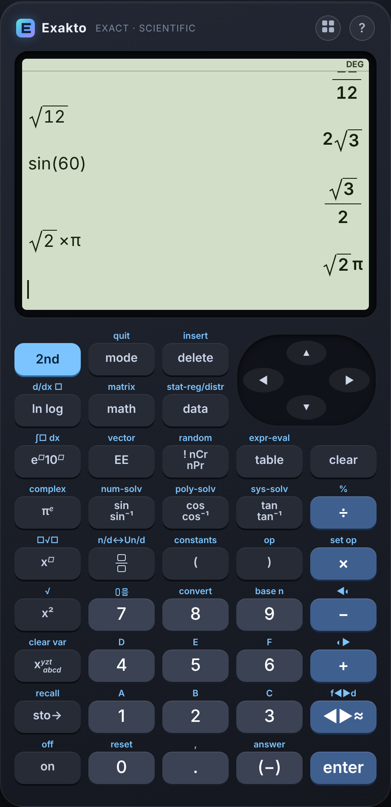
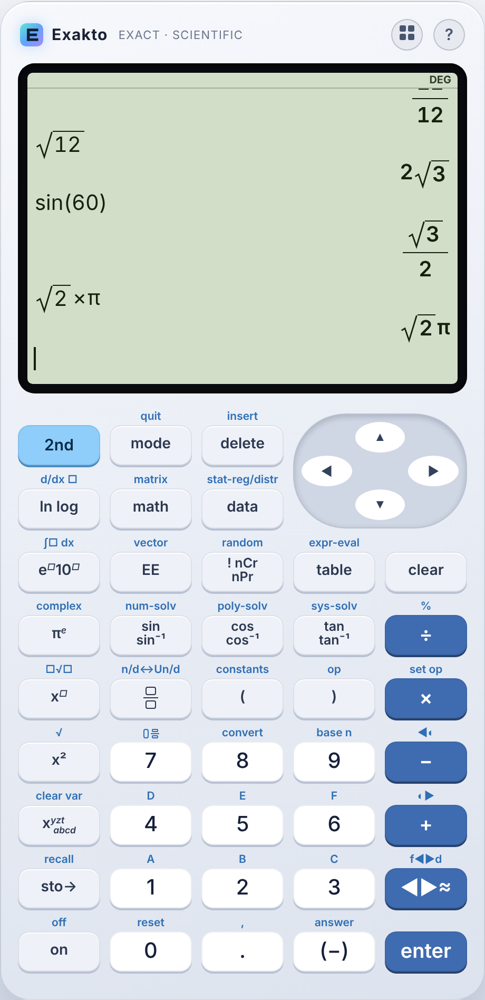
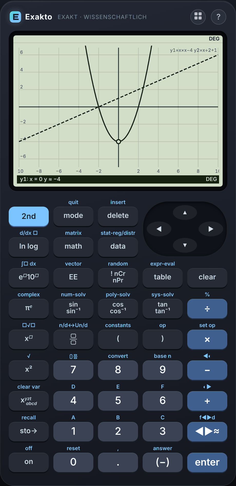
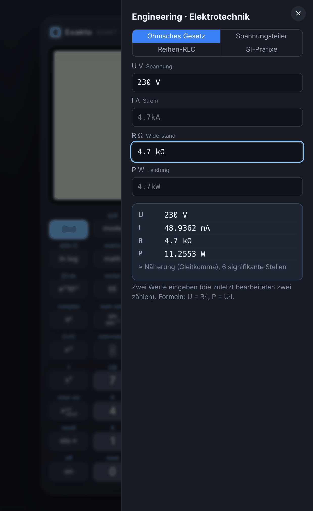

<div align="center">


# Exakto

**Exact mathematics. Anywhere.**

Scientific · Offline · Open Source

**[▶ Live-Demo ausprobieren](https://morenobueno.github.io/exakto/)**

   

Brüche, Wurzeln und π bleiben exakt – als Schulbuch-Darstellung, offline nutzbar, ohne Abhängigkeiten.

[Deutsch](README.md) · [English](README.en.md)

 &nbsp; 

</div>

## Warum Exakto?

Viele Schul- und Studienrechner rechnen exakt (`2/3 + 1/4 = 11/12`, `√12 = 2√3`), im Browser gibt es dafür aber kaum etwas Brauchbares. Exakto bringt diese Arbeitsweise auf den PC: bedienbar mit Maus, Tastatur und Numpad, installierbar als App und komplett offline.

## Funktionen

- **Exakte Arithmetik:** Brüche, gemischte Zahlen, vereinfachte Wurzeln, Vielfache von π, exakte Winkelwerte (30°/45°). Mit `◀▶≈` zwischen exakt und dezimal wechseln. Exakte Ergebnisse und Näherungen sind klar getrennt.
- **Schulbuch-Eingabe:** Brüche, Wurzeln, Potenzen, Betrag, Σ, Π, ∫ und d/dx werden wie im Buch dargestellt und per Pfeiltasten bearbeitet. Rückgängig/Wiederholen mit `Strg+Z` / `Strg+Y`.
- **Funktionen:** Trigonometrie und Hyperbelfunktionen, ln/log, nCr/nPr, ggT/kgV, Winkelumrechnung, Polar/Kartesisch, 23 Konstanten, Einheitenumrechnung, Zahlensysteme (Bin/Oct/Dec/Hex).
- **Graphen (`F2`):** bis zu drei Funktionen, Zoom, Verschieben, Trace; Polstellen (`1/x`, `tan x`) werden nicht verbunden.
- **Engineering (`F3`):** Elektrotechnik mit SI-Präfixen (`4.7k`, `100n`, `47µ`) und Einheitenprüfung: Ohm, Spannungsteiler, Reihen-RLC mit Impedanz, Resonanz und Leistungen.
- **Analysis & Statistik:** numerische Integration und Ableitung, Summen/Produkte, 1-Var/2-Var, Regressionen, Normal-, Binomial-, Poisson- und geometrische Verteilung.
- **Löser:** Gleichungen (numerisch), Polynome Grad 2/3 (exakt, auch komplexe Lösungen), Gleichungssysteme 2×2/3×3, Wertetabelle.
- **Komfort:** Verlauf, Variablen und Listen bleiben lokal gespeichert. Rechnung als **Link teilen**, Verlauf als **CSV exportieren**.
- **Bedienung für alle:** hell/dunkel, drei Grössen, Deutsch/Englisch, vollständig per Tastatur bedienbar, beschriftete Tasten und angesagte Ergebnisse für Screenreader, Touch-Ziele ≥ 44 px, reduzierte Bewegung.
- **Offline & installierbar (PWA)** – ohne Server, ohne Tracking, ohne Abhängigkeiten. Zusätzlich als **eine einzige HTML-Datei** (`exakto.html`).

<div align="center">
 &nbsp; 
</div>

## Bekannte Grenzen

- Keine komplexen Zahlen, Matrizen und Vektoren im Hauptrechner; `op`/`set op` fehlen.
- Dezimaleingaben (`0.1`) sind Näherungen; ganzzahlige und Bruch-Eingaben bleiben exakt. Kein vollständiges Computeralgebrasystem.
- Numerische Nullstellensuche, Integral und Ableitung sind Näherungen. Kein endliches Raster findet garantiert alle Nullstellen.
- Einheiten gibt es nur im Engineering-Panel (Prüfung je Feld), nicht im Hauptrechner.
- Berechnungen laufen im Hauptthread; Grenzen für Ausdruckslänge und Zahlengrösse schützen vor Hängern.

Details: [docs/MATH.md](docs/MATH.md) · [docs/ARCHITECTURE.md](docs/ARCHITECTURE.md)

## Benutzen

**Online (GitHub Pages):** [https://morenobueno.github.io/exakto/](https://morenobueno.github.io/exakto/) – kostenlos, ohne Anmeldung, funktioniert danach auch offline.

**Lokal, ohne alles:** `exakto.html` (aus den Releases oder per `npm run build:standalone` in `release/`) im Browser öffnen. Es ist eine einzige, eigenständige Datei und läuft ohne Netz.

**Als App:** Auf der Pages-Adresse im Browser „Installieren“ bzw. „Zum Startbildschirm“ wählen.

Das Menü (Gitter-Symbol) wechselt zwischen Wissenschaftlich, Graph und Engineering; Einstellungen und Bedienung stehen hinter dem **?**-Knopf (oder Taste `?` / `F1`). Wichtigste Kürzel: Ziffern/Numpad wie gewohnt, `^` Hochzahl, `Enter`, `Esc` = clear, Pfeiltasten navigieren, `Tab` = 2nd, `S C T L` sin/cos/tan/ln·log.

## Entwicklung

Voraussetzung: Node.js ≥ 20, sonst nichts.

```bash
npm ci                    # Abhängigkeiten (aktuell keine) laut Lockfile
npm test                  # baut dist/ und führt alle Tests aus
npm run build             # Website -> dist/
npm run build:standalone  # Einzeldatei -> release/exakto.html
npm run serve             # http://localhost:8080 (für PWA / Service Worker)
```

Aufbau und Datenfluss: [docs/ARCHITECTURE.md](docs/ARCHITECTURE.md). Beiträge: [CONTRIBUTING.md](CONTRIBUTING.md). Sicherheit: [SECURITY.md](SECURITY.md).

### Eigene Kopie veröffentlichen (Fork)

1. Repository forken oder den Inhalt in ein eigenes öffentliches Repository `exakto` pushen (Branch `main`).
2. **Settings → Pages → Source: GitHub Actions** wählen.
3. `pages.yml` testet, baut und veröffentlicht bei jedem Push auf `main`; `ci.yml` prüft zusätzlich Pull Requests ohne Schreibrechte.
4. Für einen Download-Release: Tag `v1.1.0` pushen, `release.yml` hängt `exakto.html` an.

Die Adresse deiner Kopie lautet `https://BENUTZER.github.io/exakto/` (`BENUTZER` ersetzen). Alle Pfade sind relativ, das Projekt läuft im Unterpfad. GitHub Pages und Actions sind für öffentliche Repositories kostenlos.

## Roadmap

- [x] **A · Fundament:** Rechenkern mit Tests aus der Projektvision, Grenzen für Ausdruckslänge
- [x] **B · Öffentliche Alpha:** responsives UI, Tastatur, README, MIT, Pages-Demo, HTML-Download
- [x] **C · Offline:** PWA, versionierter Cache, lokale Daten
- [ ] **D · Fachmodule:** Komplexe Zahlen, Matrizen/Vektoren, Graph-Analyse (Nullstellen, Schnittpunkte), weitere Engineering-Module
- [ ] Web Worker für abbrechbare lange Berechnungen, Warnung bei fehlender Integral-Konvergenz
- [ ] Browser-Tests (End-to-End) in der CI, Test auf echten Mobilgeräten und mit Screenreadern
- [ ] **E · Version 1.0** nach Abschluss der Fachmodule

Beiträge sind willkommen, siehe [CONTRIBUTING.md](CONTRIBUTING.md).

## Hinweis

Exakto ist ein unabhängiges Open-Source-Projekt und nicht mit Taschenrechner-Herstellern verbunden. Alle Markennamen gehören ihren Inhabern. Die Ergebnisse sind sorgfältig getestet, ersetzen aber keine Prüfung bei wichtigen Berechnungen.

## Lizenz

[MIT](LICENSE)
